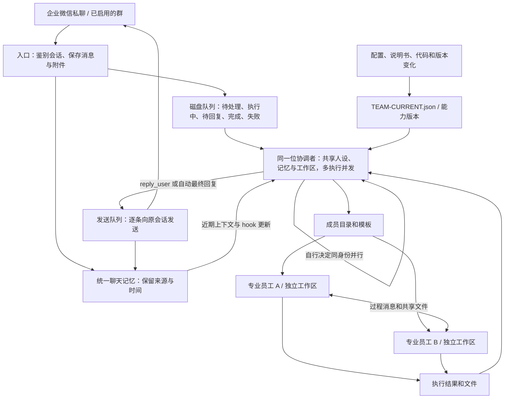

# 协调者与 AI 团队

用户面对由自己配置的负责人。它是 AI 员工，负责理解目标、组织专业同事、跟进过程和检查交付。日常交流不要求用户理解 Claude Code、DSH 或模型路由。

## 核心和渠道

核心进程管理成员目录、ACP 运行时、MCP 工具、事件、执行结果和主网络节点。它可以在没有消息渠道、机器人账号、企微 SDK 的情况下工作。CLI 与其他主网络直接进入核心服务。

企业微信是可选的独立包 `@shiyanjia/agent-network-wecom`。它管理 WebSocket、群权限、附件、收发队列、聊天记忆，以及员工完成后如何恢复到原企微会话。核心提供运行事件、过程消息、结果和回复挂接点；渠道负责把它们转换为平台行为。实例每次显式启用一个渠道。模块通过 `startChannel(network)` 返回渠道对象，API v1 包含 `id`、`coordinatorId`、`ownsRun`、`activity`、`resume` 和 `close`。渠道自己的状态与凭据保存在实例，核心升级通过接口确认就绪。下面关于企微接单和跨群聊天的行为适用于启用了企微模块的实例。

## 四个独立概念

| 概念 | 职责 |
| --- | --- |
| 员工身份 | 名字、人设、专长与工作目录；可长期存在，空闲时不必持续运行进程。一个员工可以通过多个群和私聊沟通。 |
| 员工模板 | 招募配置；需要时创建新身份和独立目录，适合并行专业工作。 |
| 运行时 | 执行工具和原生 Agent 循环；当前是 Claude Code 和 DSH，由负责人管理。 |
| 模型 | 员工可独立选择的推理服务；模型 ID 和网关由每个实例的所有者配置。 |

固定员工每轮读取最新配置；临时员工保留创建时的配置快照，负责人可以显式更新。所有员工都有自动分配的默认工作目录，作为运行时启动目录。模型或运行时变化时开始新会话，文件和旧会话索引保留。

## 接单与恢复

入口按聊天调度，同一位协调者默认可同时处理 4 个聊天。不同聊天有独立原生会话和运行配置，员工身份、人设、工作区和团队保持共享。每个聊天入口同一时刻只有一轮执行，后续消息经原生 hook 注入这一轮；协调者可自行用 delegate 的 parallel=true 在同一身份、同一工作区另开原生执行，不需要创建员工。入口并发上限不计显式委派的子执行；每个并行子执行完成后释放对应原生进程，记录和文件保留。网络不对消息做语义分类，补充或另开工作由协调者自己判断；运行时启动阶段到达的补充同样接入。只有消费补充且父任务完成，补充记录才算完成，未消费项下一轮续办。回复失败只阻塞该聊天的后续任务，其他聊天仍可执行；对外发送队列继续逐条投递。

MCP、hook、活动执行和临时邮箱按会话及运行 ID 路由，父子任务用 parentRunId 关联，附件不再按员工 ID 和时间区间猜归属。Claude 的工作区 hook 命令是公共的，端点文件来自当前进程环境；DSH 使用各会话私有 profile。最终回复、状态查询和停止命令定位原会话。原先的共享原生会话保留，各聊天以工作区 history/conversations 索引接续旧消息与结果。

统一记忆位于协调者工作区的 .memory/shared，每条输入、附件与已发送回复独立存盘。新执行自动获得近期 24 条的片段和完整文件路径；历史检索复用原生文件工具。正在执行的协调者在 hook 边界接收增量，带来源标记；直接注入的同一输入去重。原生会话彼此独立，跨群延续依靠这份共享记忆，不依赖合并运行时内部状态。升级时从已有入口与发送队列导入，已落盘记录按来源 ID 去重。

同身份子执行通过 originMessageId 固定回复目的地，父执行结束后仍能调用 reply_user。send_message 的 targetRunId 用于明确选择并行执行；目标已经结束时返回失败，不转发到后来的任务。状态与停止命令包含该来源的活动子执行。

绑定用户首次在群里交代任务时自动启用，不需要固定口令；其他成员不能启用群。企业微信平台当前需要群内 @ 才推送消息，私聊不需要。先前按群拆分的历史和文件保留，索引放入同一助手的 history/wecom-legacy.json，旧未完成项由该助手续办。

先落盘，再排队处理；不发送“收到”等占位提示，等待实际回复。进程停止后，未处理的消息继续排队；中断的执行带上恢复说明重新接手；已有最终结果但回复失败时，只重发结果。普通执行错误保留为 failed，可用 `/重试` 再处理。

主控通过 reply_user 随时主动回复，调用完成只表示消息入队，任务可以继续执行。收件人取自当前队列任务，模型不能通过这个工具改投其他群。工具消息、自动最终回复和最终附件由同一个持久发送队列处理。任务中用过 reply_user 后，后续对外文字都由该工具负责，最终文本仅作内部记录；没有使用时保留最终回复兜底，执行失败仍通知用户。

消息送达后保存回执，重启继续未发送部分。附件入队时保存快照，防止共享工作区后续修改改变待发文件。发送中断时保留待发内容，不增加成员心跳或跨机器消息总线；企微已接收但本机还没保存回执时崩溃仍可能重复。

这里保证已接收内容可恢复，不保证外部动作 exactly-once。恢复时核对文件和旧会话，避免重复操作。未到达本机的离线消息无法靠本地队列恢复。

## 专业员工完成后的续办

运行器在保存员工结果后调用完成事件接口；企微入口将带有原用户来源的专业员工结果写入现有本地队列，kind=member_completed，以完成的 runId 去重。事件处理与企微 SDK 分开，CompletionEvents 负责父任务关系、hook 注入和续办，入口负责消息来源与最终交付。没有增加意图分类或成员心跳。

原协调者执行仍活动时，事件定向注入该执行；若正在处理同一父任务的验收轮，也可接收后续成员结果。hook 消费记录与事件 ID 关联。如果执行恰好结束而没有消费事件，事件改为 pending，交给原聊天入口启动验收。同一来源的另一个无关请求正在执行时，事件等待，不投到那个请求。并行协调者的父执行也有独立的事件收尾，避免 attached 记录悬空。

验收执行保存 continuationOfRunId、originMessageId、originRunId、resultRunIds；它是内部续办，不把已完成员工设成新父任务，因此结束不会产生唤醒循环。原用户来源不变；员工文件即使不在协调者工作区，也可沿结果引用加载并交付。完成事件不作为用户输入写入统一记忆，实际对外回复照常记录。专业父员工已结束时，可向上找到原协调者接管迟到结果；显式停止的父任务不自动续办。

已落盘的事件通过原队列恢复；这是有限的本地续办机制。运行中的专业员工没有因此获得通用崩溃重跑能力，普通过程消息仍为 best effort。事件入队失败记录在员工结果 completionError；结果保存与事件入队不是跨文件事务。不回放升级前的所有历史完成结果。

## 能力感知与维护

负责人和专业员工每轮得到同一个网络 Skill 的路径与修订号、自己的职责和所属范围的 TEAM-CURRENT.json。网络版本来自 package.json，发布包带独立 buildId；规范修订与配置能力快照分别计算。首次协作或修订变化时读规范，具体管理员工时再读负责人参考。工作区 TEAM.md 是入口指针；仓库维护一份网络使用规范。

负责人通过三个协作工具组织团队，并通过 reply_user 向用户主动发消息；员工管理复用原生 shell 调用 team CLI。升级命令采用项目内安装、兼容检查、激活和回滚；独立重启进程负责关闭旧服务、启动新服务，接收与发送队列恢复未完成工作。联系另一个主网络时，接单方式由各自的负责人管理。

这些是本机协作与维护机制。是否能正确完成具体任务、设计升级或修复任意故障，需要逐项验证，不能由架构本身推出。

网络的应用包、实例状态和升级操作如何分开，见[版本与升级规范](RELEASING.md)。

网络应用由独立的 Node.js 命令 `agent-network-release` 发布。它和 `agent-network` 随同一个核心 npm 包安装，完成操作后退出。实例 `current` 指向已核验的版本目录。服务在排空时保留企微接收和原任务，新的应用验证身份和认证后恢复派工。运行时 slot 和网络应用分别升级，完整操作方式见[发布规范](RELEASING.md)。

外部成员由本机入网目录管理。运行时、网络成员和历史会话分别标识。每个实例自行配置协调者，Claude Code 与 DSH 是已有执行适配器。加入方用独立凭据声明精确项目范围，所有者批准后发布自述和运行时快照。发现地址不携带工作或维护令牌，外部成员的凭据只能管理自己的报告。报告按项目替换，离线可查，数据中保留报告时间和不完整标记。显式关联已有专业员工时才使用现有 ACP/MCP 执行链路，Codex 历史索引用官方 App Server 的只读接口。每个实例独立保存 `.local/member-directory.json`。

### 旧版同机节点

主网络可以选择以一个节点加入另一个主网络。每对网络以稳定 UUID 标识，在本机使用独立的 Unix socket 和专属于该对关系的凭据交换文本。主服务、维护凭据和内部员工 API 仍分别独立。加入方先保存本地意愿，接收方回查加入方的真实端点后登记待审。批准后双方才可通信，每次收到消息都核对两端当前关系。主管退出或撤销后，旧凭据对应的消息不能开启新任务。两侧的 `.local/network-links.json` 只由各自实例管理。

对外在现有 `send_message` 中使用 `node:别名`。接收方以本机主协调者和独立节点会话承接消息；过程回复用不包含本机运行编号的临时标识返回仍活动的原轮。已结束或已重启的原轮通过节点会话承接后续消息。节点服务属于同一 OS 用户的本机通信，不设心跳、持久投递或跨主机发现。

### 经批准的跨机器联系人

核心提供联邦接入。每个实例把独立的 Ed25519 私钥放在自己的私有目录，把稳定网络 UUID、Peer ID 和本次关系编号绑定到联系人。双方确认后，`send_message` 使用 `node:别名`。同 UID 机器上优先用 Unix socket，其他机器使用固定的 Circuit Relay v2。两端通过 Noise 独立握手。中转可观察身份与流量元数据。发送后失去回执时返回 `delivery_unknown` 和消息编号。

收件、票据与联系人在本机落盘。返回绑定具体执行、会话和渠道队列项，跨网只携带随机票据。活动轮 hook 接收可信来源通知，渠道按本地票据将文字交付原会话。晚到的结论进入同一会话的无工具续办，重启后恢复已接收的事件。外部正文隔离于助手的共享记忆和原生 shell。远端没有本地授权的文本模板时由本机负责人查看收件箱并决定回复。[安装与互联](INSTALL.md#连接另一台机器上的主网络)
