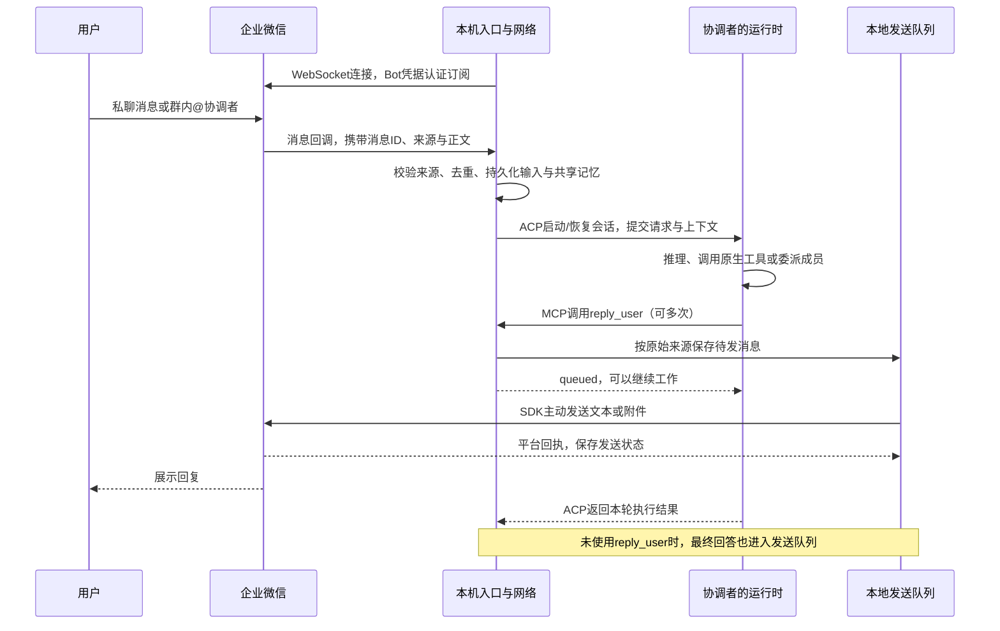
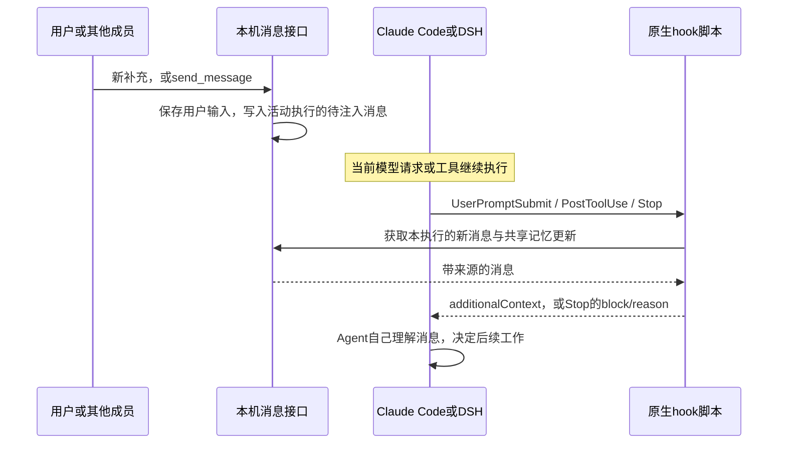

# 企业微信入口与运行时的实际连接方式

本机运行的应用目录和实例目录分别见 `TEAM-CURRENT.json` 的 `networkRoot` 与 `instanceRoot`。企业微信的消息入口、员工执行和模型网关是三层：企微负责消息，本机网络负责接入与协作，Claude Code / DSH 负责执行 Agent 循环。New API 仅是模型调用网关，不承接企微回调。

## 收到任务与主动回复

使用已安装的官方 `@wecom/aibot-node-sdk` 1.0.7，通过本机主动建立的 WebSocket 长连接认证与订阅。无需给 Mac 配公网回调地址。SDK 管理企微连接的保活与重连；成员本身没有心跳注册要求。

普通任务不先发送“收到”。使用 `reply_user` 后，该轮的后续对外文字都通过该工具发送，原生最终文字只作内部记录，避免重复回复。管理命令如状态查询走 SDK 的直接回复接口。

接收队列与发送队列分别落盘，发送只有一个消费者。这个发送顺序不限制 Agent 的执行并发。已接收但未处理的入口消息可在重启后续办；已确认发送的项目保留回执，无法保证进程在回执落盘前退出时绝不重复。未推送到本机的离线消息不属于本地队列保证。

## 执行中如何插入消息

MCP 提供 Agent 主动调用的工具，不承担服务向 Agent 推送上下文。hook 脚本在运行时边界调用本机 `/inbox`。普通 hook 返回 `additionalContext`；结束边界若发现消息，返回 `block/reason` 让运行时继续处理。长命令和模型请求期间等待下一个边界，不做生成中途的强制打断。

专业员工完成后，结果会形成独立的内部事件：原协调者仍活动则 hook 注入；已经结束则按原用户来源排队启动验收。队列用员工 runId 去重，未消费的完成事件能续办，显式停止的原任务不会被重新唤起。验收结束不触发反向委派或唤醒循环。

网络没有“新任务／补充”的语义分类器。协调者可自行继续当前工作、联系专业员工，或者使用已有 `delegate` 的 `parallel=true` 开启同身份的并行执行。`send_message` 可指定 `targetRunId` 定向同步；`get_result` 查询完整执行结果。

## 两种运行时

| 项目 | Claude Code | DSH |
| --- | --- | --- |
| ACP接入 | `claude-agent-acp` 适配器再调用 Claude Code | `dsh --profile acp` |
| 本机通信 | stdio 上的 ACP JSON-RPC | stdio 上的 ACP JSON-RPC |
| 模型请求 | New API 的 Anthropic Messages 接口 | New API 的 OpenAI Chat Completions 接口 |
| hook配置 | 工作区 `.claude/settings.json`，使用 Claude 原生hook | 独立ACP profile加载 `@deepseek-ai/dsh-hooks-claude-code` |
| 确定当前执行 | 环境变量指向该执行的私有端点文件 | hook命令携带该执行的私有端点文件路径 |
| MCP工具 | 同一个 `local-network` stdio服务 | 同一个 `local-network` stdio服务 |
| 原生配置与会话 | 各执行独立 `CLAUDE_CONFIG_DIR` | 各执行独立 `DSH_HOME` |

两者均由本机 ACP 客户端执行 initialize、session/new 或 load/resume、session/prompt、session/cancel。Agent 自己负责工具选择和模型循环。本网络不使用 acpx。运行时和模型独立配置，具体实例中协调者选用的模型见 `TEAM-CURRENT.json` 的员工配置。

## 同一位协调者与并行执行

身份、人设和工作区属于实例选择的负责人 ID，默认工作区是 `.local/workspaces/<负责人ID>`。不同群和私聊的入口使用独立原生会话；同群并行子执行也使用独立原生会话，但不会因此创建另一个员工或工作区。

聊天记忆统一存放在工作区 `.memory/shared/`。输入、附件路径和已发送回复保留来源和时间；新执行自动获得近期记录，运行中通过 hook 得到更新，更早内容可用原生文件工具检索。原生隐藏会话状态没有硬拼接成一个会话。

入口默认最多同时启动 4 个聊天；这个名额不计显式委派的子执行。同身份子执行按原始消息 ID 固定回复目的地，父执行结束后仍能调用 `reply_user`；完成后释放独立原生进程。同群是否另开执行由协调者决定，不是一收到消息就自动创建新任务。

用户附件由 SDK 下载并解密到工作区，再把本机路径传给 Agent。入口任务的最终记录中明确列出的交付文件进入发送队列，保存快照后经 SDK 上传并发送到原会话。当前每个文件上限 20 MB，每次最终交付最多 3 个文件。同身份并行子执行的文件应交给仍在运行的入口执行交付；它自己的最终记录目前不会自动触发附件发送。

## 代码对应位置

- `src/wecom.mjs`：平台连接、鉴别来源、入队、回复目的地。
- `src/durable-inbox.mjs` / `src/durable-outbox.mjs`：本地接收与发送队列。
- `src/runtime-acp.mjs` / `src/runtime-config.mjs`：运行时启动、ACP、模型与hook配置。
- `src/mcp.mjs` / `src/hook.mjs`：Agent主动调用与执行中消息注入。
- `src/shared-context.mjs` / `src/shared-memory.mjs`：统一聊天记忆与增量上下文。
- `src/completion-events.mjs`：专业员工完成事件、原任务注入与后续验收。

以上描述基于本项目实际实现。发布验收应分别记录本机回归、平台认证和真实多群客户端测试。含实例信息的记录保存在实例自己的 `verification/`。
